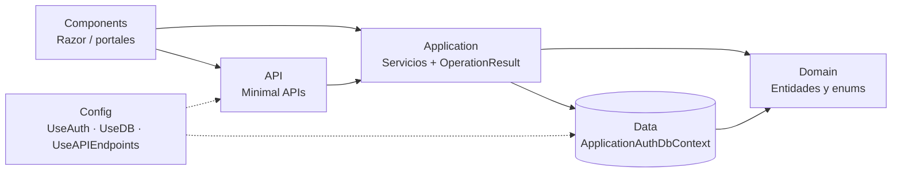
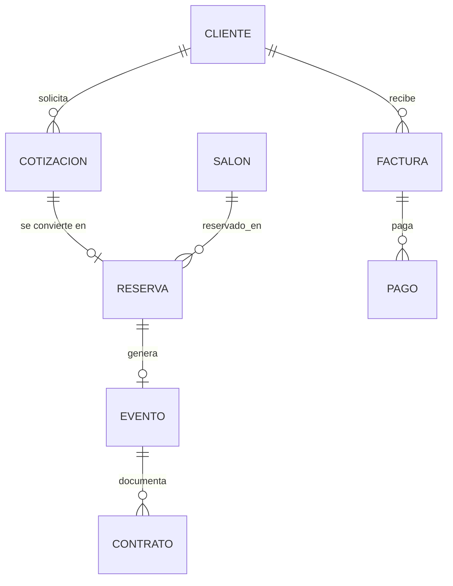
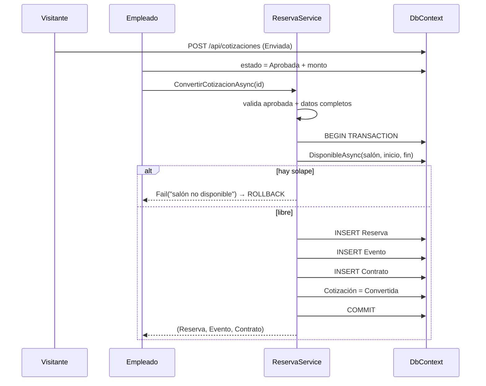

# Diapositivas de defensa — Cumbre Salones y Congresos

8 slides para una exposición de 8 minutos. Podés pasarlas tal cual a PowerPoint/Canvas/Google Slides. **No llenes las slides de texto**: lo que está en *Notas* es lo que decís, no lo que proyectás.

---

## Slide 1 — Título

**Cumbre Salones y Congresos**
Gestión integral de eventos, salones y congresos

Mini curso de Blazor · [Tu nombre]

- **Visual:** logo/nombre + una foto de salón de eventos o fondo oscuro con acento.
- **Notas:** apertura de 20 segundos. "Hoy les presento…" (ver `defensa-guion.md`, bloque 1).

---

## Slide 2 — El problema y el alcance

**Un evento pasa por muchos sistemas. Acá pasa por uno solo.**

- Catálogo de salones y convenios
- Cotización → aprobación
- Reserva + Evento + Contrato
- Cronograma, participantes, facturas y pagos

**Alcance:** Fases 0–3 implementadas (base, dominio/datos, sitio público, portales).

- **Visual:** embudo o flecha horizontal con 4 hitos: *Cotizar → Aprobar → Reservar → Facturar*.
- **Notas:** 40 segundos. No leas el README, solo la idea.

---

## Slide 3 — Stack

| Capa | Tecnología |
|---|---|
| Frontend | Blazor Web App (.NET 10), Interactive Server, Tailwind |
| Backend | ASP.NET Core 10 + Minimal APIs (`IEndpoints`) |
| Datos | EF Core 10, un `ApplicationAuthDbContext` |
| Auth | ASP.NET Core Identity, cookies HttpOnly, roles/políticas |
| DB | SQLite (dev) · PostgreSQL · SQL Server |

**Decisión clave:** C# de punta a punta, sin SPA separada.

- **Visual:** iconos por fila (opcional).
- **Notas:** 45 segundos. Mencioná el trade-off: dependencia del circuito SignalR.

---

## Slide 4 — Arquitectura por capas

- **Notas:** 45 segundos. "Config concentra el arranque; Domain no depende de nada; Application orquesta; Data persiste; Components consume servicios."
- **Si te preguntan por `IEndpoints`:** está en `Config/CumbreAPIEndpoints.cs`, discovered por reflexión.

---

## Slide 5 — Modelo de dominio (el subconjunto que importa)

**Detalles que muestran oficio:**
- Montos con `HasPrecision(18, 2)`
- Índice único en `Cotizacion.Numero` y `Contrato.Numero`
- Índice compuesto `Reserva(SalonId, Inicio, Fin, Estado)`
- `SetNull` en Reserva↔Evento, `Restrict` en Contrato

- **Notas:** 60 segundos. No leas las 16 entidades; marcá solo las 5 del flujo.

---

## Slide 6 — Flujo crítico ⭐ (la slide más importante)

**Solapamiento:** `inicio < r.Fin && fin > r.Inicio` · Bloquean `Solicitada` y `Confirmada`.

- **Notas:** 90 segundos. Acá está el corazón de la defensa. Mostrá también `ReservaService.cs:38-93` si podés.

---

## Slide 7 — Seguridad

- Identity + `RequireConfirmedAccount` + cookie **HttpOnly**
- Roles sembrados por configuración: Admin, Empleado, Marketing, Cocina, Cliente, ClienteVIP
- 4 políticas: `PortalCliente` · `PortalEmpleado` · `PortalCocina` · `PortalAdmin`
- `[Authorize(Policy = ...)]` en páginas · `RequireAuthorization(...)` en `/api`
- `/api` responde **401 / 403**, el resto redirige al login
- `UseAntiforgery()` + `SeedAuth()` idempotente

- **Notas:** 45 segundos. "La autorización está en dos niveles: componente y endpoint."

---

## Slide 8 — Estado actual y próximos pasos

**Listo:** dominio + portales público, cliente y empleado + API + seed.

**Para producción:**
1. Concurrencia: lock / `SERIALIZABLE` / exclusión por rango en la disponibilidad
2. Tests de integración (solapes, rollback, autorización)
3. Correo real, pasarela de pagos y storage
4. Migraciones fuera del arranque si hay varias réplicas

**Gracias — preguntas.**

- **Notas:** 60 segundos. Decilo con seguridad: saber qué falta también es defender bien.

---

## Tip final

Si tenés que recortar a 5 minutos: **saltá la slide 5 y acortá la demo a 2 pasos** (`/empleado/cotizaciones` → convertir → `/cliente/reservas`). Nunca recortes la slide 6.
